# Features

[README](../README.md) · [Features](features.md) · [Installation](installation.md) · [Keybinds, IPC and launcher](usage.md) · [Configuration](configuration.md)

Everything below is one shell and one config, and everything is set from inside the shell. The screenshots come from the [example setups](configuration.md#example-setups), each built entirely with axiom's editors, so the look changes from one to the next.

**On this page:** [Bar](#bar) · [Bar styles](#bar-styles) · [Overlay](#overlay) · [Layouts editor](#the-layouts-editor) · [Menus](#menus) · [Workspaces](#workspaces) · [Window switcher](#window-switcher-alttab) · [Your compositor](#your-compositor) · [Calendar](#calendar) · [Launcher](#launcher) · [Dock and OSD](#dock-and-osd) · [Lock screen, login screen and polkit](#lock-screen-login-screen-and-polkit) · [Theming](#theming) · [The rest](#the-rest)

## Bar

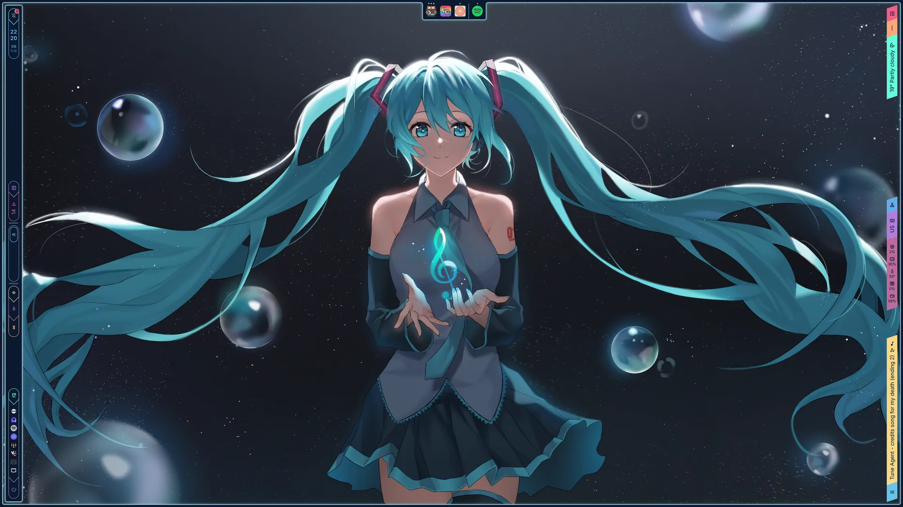

- Bars are defined in config. Have any number, on any monitor (or a copy on every one) and any edge.
- **29 widget types:**
  - Workspaces, Window, Time, NextEvent (the next event from your calendars), Media
  - Volume, Microphone, Network, Bluetooth, Battery, SystemStats, SystemTray, Notifications
  - Updates, Weather, Markets (stock and crypto prices: one at a time, a ticker or a sparkline, a popout with charts), Tailscale (with a popout of this machine, the tailnet's devices, Connect / Disconnect, account switching, the exit node and its options), Vpn, Drives (removable drives: hidden with none, a popout to open, eject or unlock one, middle click ejects them all), KeyboardLayout, LockKeys (Caps Lock, Num Lock and Scroll Lock, shown while on or always), IdleInhibitor, Privacy
  - ScreenRecord (shown while recording; click to stop), DevMode (shown while dev mode is on: the dev tree's branch, a build running or failed, a popout to rebuild or turn it off), Claude usage (your Claude Code plan limits, for one or more logins), Todo (open count), Pomodoro (the time left), Timer & stopwatch
  - Button (runs any command, opens a page or toggles a menu) and Separator
- **Popouts** grow out of the bar, or out of the screen border, with filleted corners. Widgets open theirs on hover, and Buttons can run their action on hover too.
- **The bar editor** draws each bar's sections the way the bar lays them out, on the side of the page matching the bar's edge:
  - Drag widgets in from the library, click one to edit it, and drop one on the trash can to remove it.
  - A full section scrolls.
  - It tells you, per screen, which widgets don't fit.
  - **Copy style** puts one bar's look onto others.

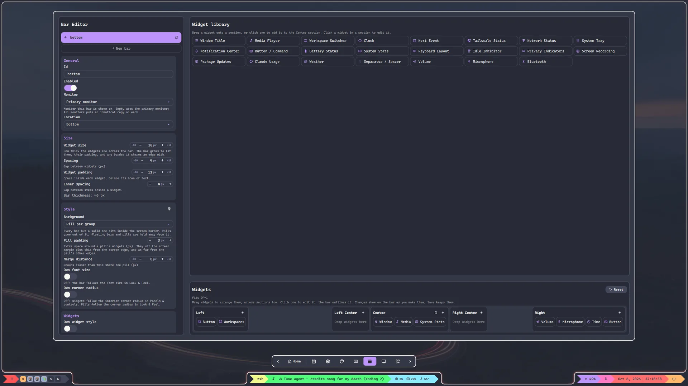

<b>Popouts</b>

| Calendar | Audio mixer | Notifications |
| :---: | :---: | :---: |
| 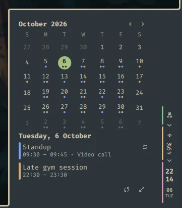 | 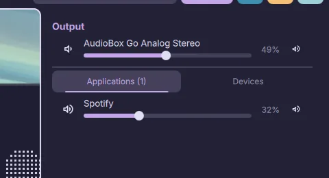 | 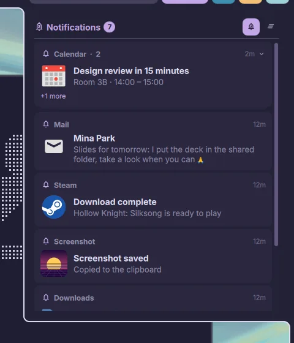 |
| **Now playing** | **System graphs** | **Forecast** |
| 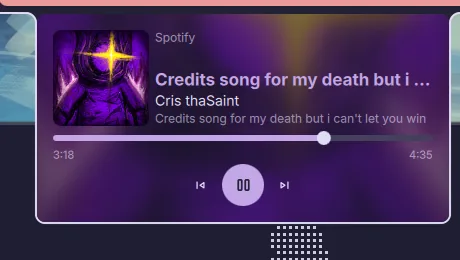 | 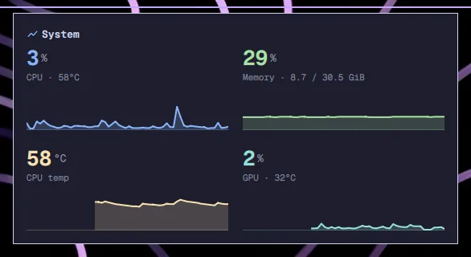 | 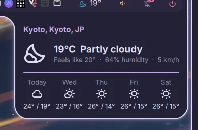 |
| **Updates** | **Workspace grid** | |
| 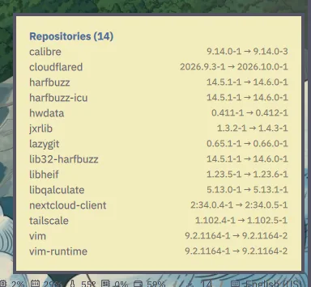 | 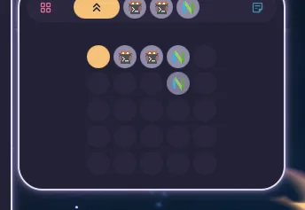 | |

### Bar styles

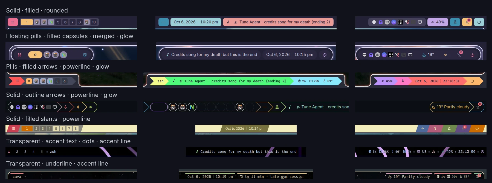

Set a style once under **Settings → Look & Feel → Bar style**, and give any bar its own. In the bar editor's **Style** tab each section (Look, Colors, Accents, Size, Shadow) is shared or the bar's own:

| | Options |
| --- | --- |
| **Background** (per bar) | solid, transparent, pills (a pill per group of widgets), floating (one bar held off the edge), floating pills |
| **Widget style** | filled, tinted, outline, underline, coloured icons, plain |
| **Shape** | rounded, capsule, slant, arrow |
| **Grouping** | separate, merged (neighbours share one background), powerline (each shape runs into the next) |
| **Ends** | shaped, pointed, rounded |
| **Separators** | none, line, dot, slash, chevron, with their thickness and margin to the widgets |
| **Accent line** | none, inner or outer edge, with an optional fade to a second color |
| **Shadow** | on or off, in the accent or any theme color |

- **Widget colors** default to **Auto**: the bar gives neighbouring widgets different accents and keeps the contrast readable. Pick a theme color for any of them instead.
- A bar can override the shared widget style, accents, shadow, font size and corner radius.
- Floating bars and pills have their own gap, and nearby pills can merge into one.
- **Translucency** (**Settings → Look & Feel → Translucency**): one opacity for every surface (bars, the screen border, popouts, menus, panels), down to 60%, with the compositor blurring behind it (Hyprland, niri, SwayFX). The blur is the compositor's own: set it from axiom under **Settings → Compositor → Window look → Blur** (size, passes, noise, …, and whether windows blur too), where window opacity lives as well, and both travel with exported and imported configs. The backdrops behind the overlay, launcher and power menu can frost the whole screen.
- **Size** (**Settings → Look & Feel → Panels & controls**), for everything outside the bars:
  - **Interface scale** (75–150 %): text and controls in the overlay, menus, popouts, the launcher, settings and notifications.
  - **Card size** (50–150 %): how big module cards are, as a share of the screen. At 100 % two cards fill its shorter side, so a monitor gets the same cards turned either way. Text keeps its size, so on a smaller screen a higher card size gives modules back their room (the overlay stays within its screen). The overlay, edge menus, desktop, lock and login screens each scale it with their own **Module size**, which zooms their text and content with the cards.
  - **Density** (compact, normal, roomy): how tightly controls, padding and gaps are packed.

  These are yours: an imported setup keeps your sizes unless you take its personal parts too.

## Overlay

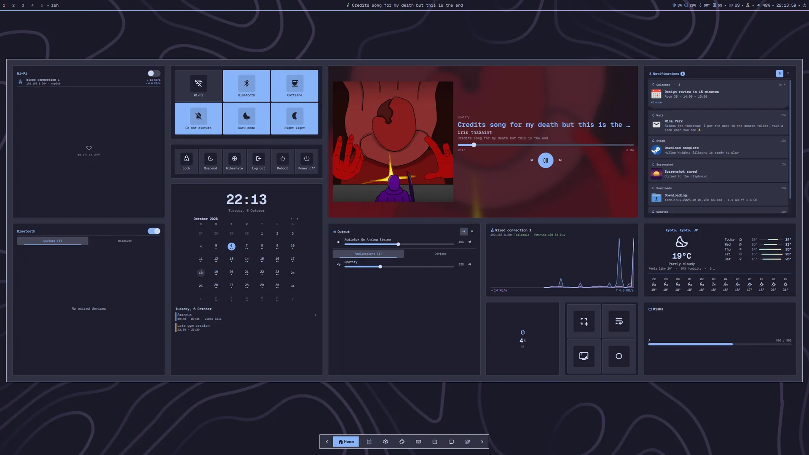

- A full-screen overlay made of pages. Each page is a grid you place modules on, with gaps wherever you like. Pages have their own name and icon in the navigator.
- **43 modules**, and every one adapts to its size and shape (square, wide or tall, down to a compact figure):

  | Group | Modules |
  | --- | --- |
  | Media and sound | Now playing, Audio mixer, Volume dials |
  | System | System graphs, Top processes, Disks, Removable drives, Battery (with connected Bluetooth devices' batteries), Updates, Network, Tailscale |
  | Controls | Quick actions (toggles, power, pin), Screenshot, Screen recording (region or screen, with sound, recent recordings), Night light, Brightness, Bluetooth devices (pair, connect, rename, auto-connect, block, forget; discoverable, unblock), Wi-Fi networks, Favourite apps |
  | Time and plans | Clock (digital, stacked or analog, in any time zone), World clocks, Clock & calendar, Calendar, Agenda, Weather, Markets (stock and crypto prices, holdings, charts from a day to a year) |
  | Workspace | Workspaces map, Notifications |
  | Writing | Notes, AI chat |
  | Focus | Todo list, Pomodoro timer, Timer & stopwatch (one-off timers with presets, a stopwatch with laps), Focus (the timer, the todos and today's events together), Caffeine (keep awake until turned off or for a set time) |
  | Utilities | Calculator (with a keypad; math, units and currencies), Clipboard history (with pins), Emoji picker, Command output (any command's output as a card), Keybind cheat sheet |
  | Look | Theme picker, Wallpapers, Palette, Theme color swatch, Greeting |

- **Built-in pages:**
  - **Settings**, generated from the config schema
  - **Bar editor** and **Layouts** (see [the Layouts editor](#the-layouts-editor))
  - **Themes**, **Keybinds**, **Window rules**, **Monitors** and **Calendar**

  Tool pages sit after your own in the navigator, as icons, and any of them can be hidden.
- **Page windows:** Settings, Themes, the Bar editor, Keybinds, Window rules, Custom widgets and Calendar open in a window of their own from the navigator's pop-out button (or their app launcher entries, e.g. *Axiom Settings*), to keep them beside what they change. The window's own button puts the page back in the overlay, as does closing it. While a page is in a window, the overlay shows a box in its place (**Bring here**, **Go to window**), and anything that opens the page by name (its `/` command, a keybind, a link) goes to the window. A link in a window to another page opens the overlay, whose back chip returns to the window. Unsaved edits carry over both ways.
- Every page has an opener: a bar button or a keybind that opens the overlay on it, added from the editor in one click.
- **Page switcher** on the bottom or top edge, naming every page while they fit, only the current one, or none (icons only). Scroll over it to step through the pages.
- The overlay slides in from the top or bottom, or fades in, over a dimmed screen whose darkness you set (or no dimming at all).

<b>Built-in pages</b>

| Settings | Keybinds |
| :---: | :---: |
| 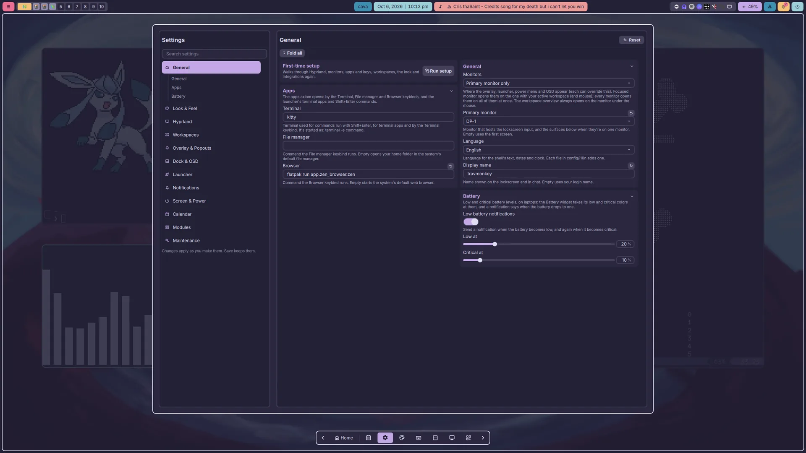 | 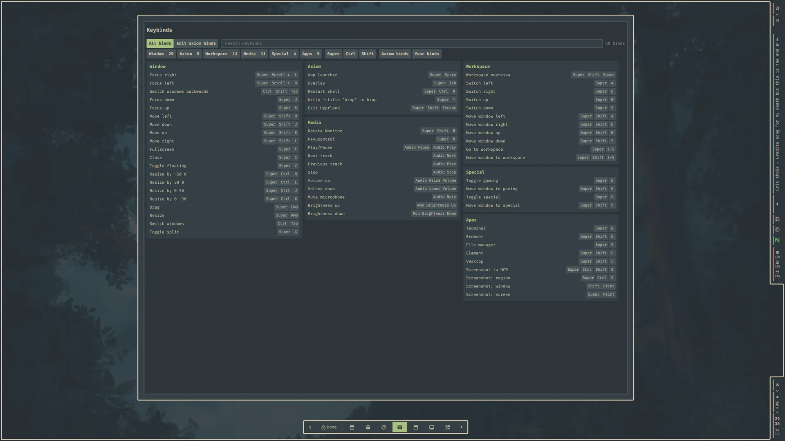 |
| **Look & Feel** | **Monitors** |
| 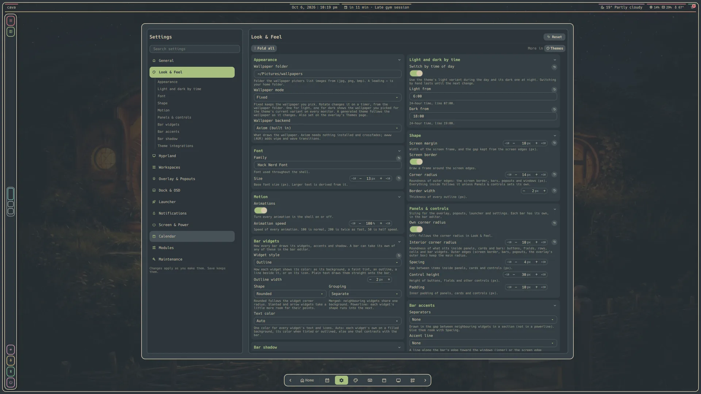 | 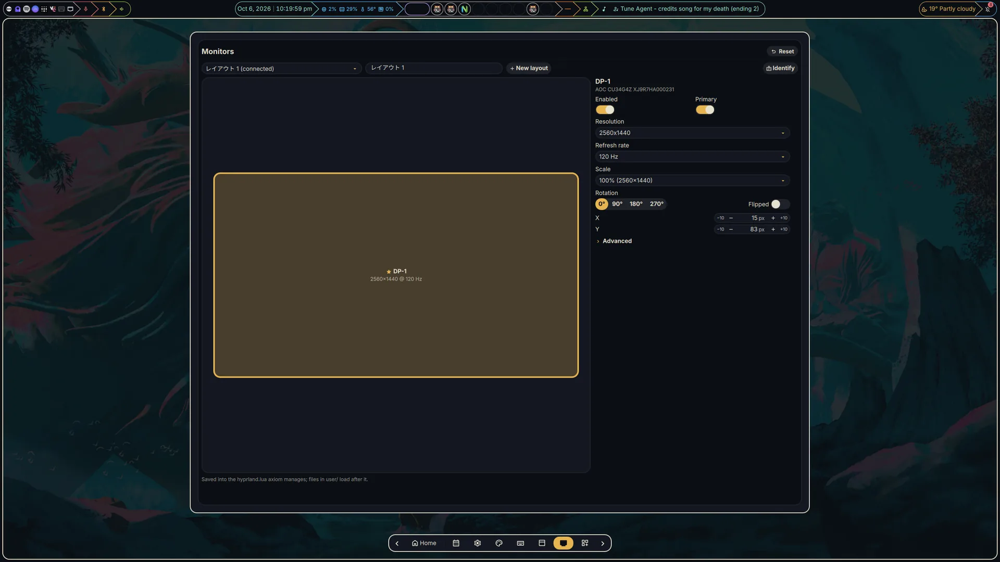 |

## The Layouts editor

One editor, one grid, for everything made of modules: your **overlay pages**, your **menus**, the **desktop**, the **lock screen** and the **login screen**.

| A page | A menu |
| :---: | :---: |
| 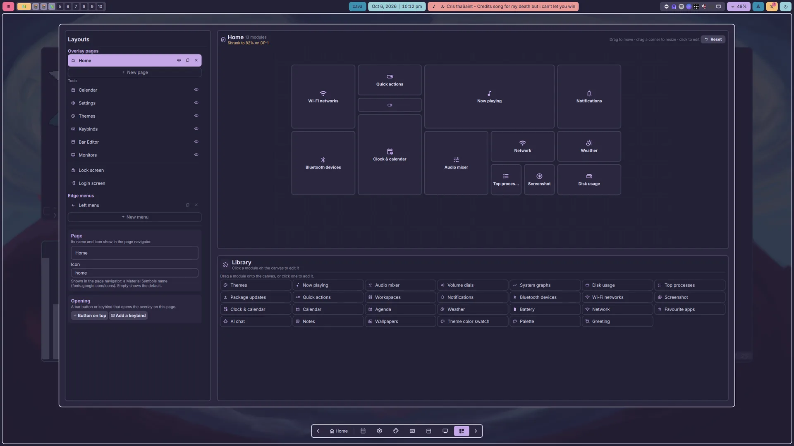 | 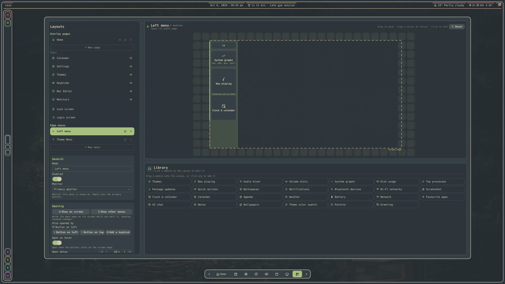 |
| **The lock screen** | **The login screen** |
| 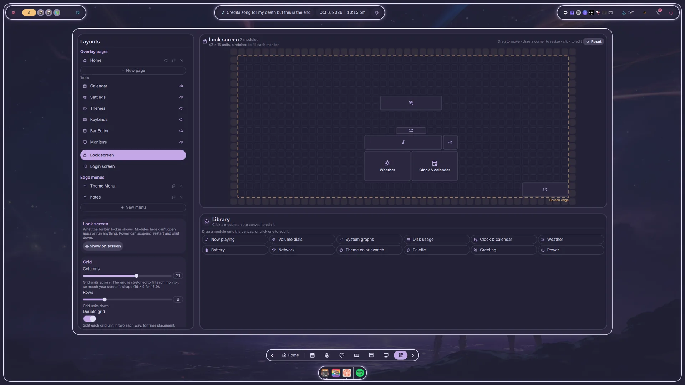 | 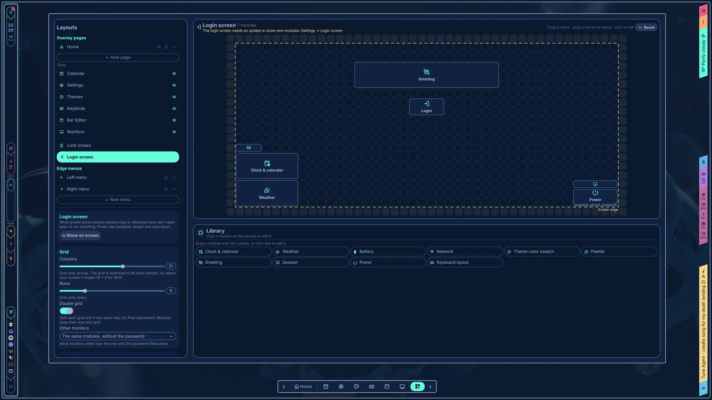 |

- Drag a module from the library onto the grid (or click it to drop it in the first free spot): dropped into a gap it shrinks to fit, dropped onto other modules it pushes them aside (down a page, along an edge menu's edge), and you see where everything will go before you let go. Drag a module anywhere, and drag any edge or corner to resize it.
- Drag a box (or Shift/Ctrl+click) to select several modules and move them together, or drop them on the trash can to remove them.
- Undo and redo every edit (buttons, or Ctrl+Z / Ctrl+Shift+Z), and move or resize the selected module with the arrow keys (Shift to resize).
- Click a module to edit its options in the inspector, which also has steppers for its exact size.
- Menus on an edge are drawn against their screen edge. The desktop and the lock and login screens are fitted to each monitor: every screen gets as many grid units as fit at your card size, and modules keep to their nearest edge, so a corner stays a corner on a wider or turned screen. Each has its own Module size and an optional double grid for finer placement.
- **Desktop widgets:** modules on your desktop, under your windows, fitted inside the bars and border so they line up with your tiled windows. They sit straight on the wallpaper (or in frosted cards) and take clicks, while the empty desktop is clicked through. One layout can cover all monitors, the primary monitor, or a monitor of its own (by name, so a laptop's screen keeps its layout when you dock and undock).
- Every change shows live on your desktop (or on screen, for the lock and login screens, with **Show on screen**). **Save** keeps it, **Discard** throws it away.
- Each page and menu lists what opens it, and adds a bar button or a keybind for it.

## Menus

Menus are the overlay's other half. Every overlay module fits in them, placed on the same grid, but a menu slides out of a screen edge, or floats on its own, and leaves the rest of your desktop in view. Use them for what you want one hover away.

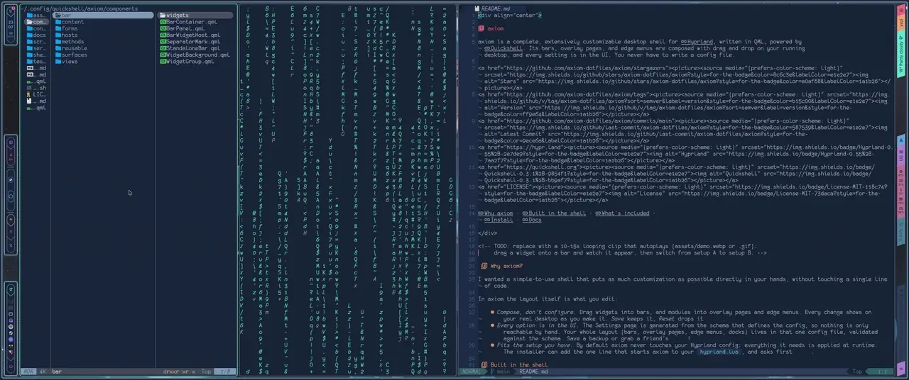

- **Edge** menus open over your windows. They grow out of the screen border or a solid bar like the popouts, or sit apart as a box.
- **Strip** menus open outside the border and bars. They push the bars and your windows inwards, like a sidebar, and give the space back when they close.
- **Free** menus float in a window of their own: at the bar widget that opens them as its popout, beside another menu as its submenu, or where a keybind puts them. Pinned, they stay under the popouts you open over them.
- **Opening a menu.** Rest the pointer on its edge, or use a bar **Button**, a keybind, or IPC (`menu toggle <id>`).
- **Closing it.** A menu can close when the pointer leaves or when you click outside it. Its pin button, or the pin quick action, keeps it open.
- **Per-menu settings.** Each menu has its own:
  - edge, monitor and position along the edge
  - length: fit its modules, or take the whole edge
  - module size and colors
  - hover timings

  A strip menu can also draw a framed box along the whole edge.

| Left: media at hand (edge) | Right: chat beside the bar (strip) | Right: the week ahead (strip) |
| :---: | :---: | :---: |
| 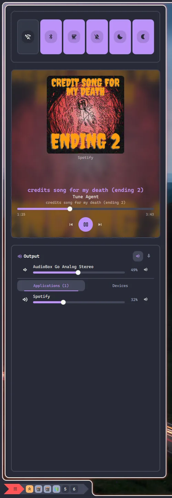 | 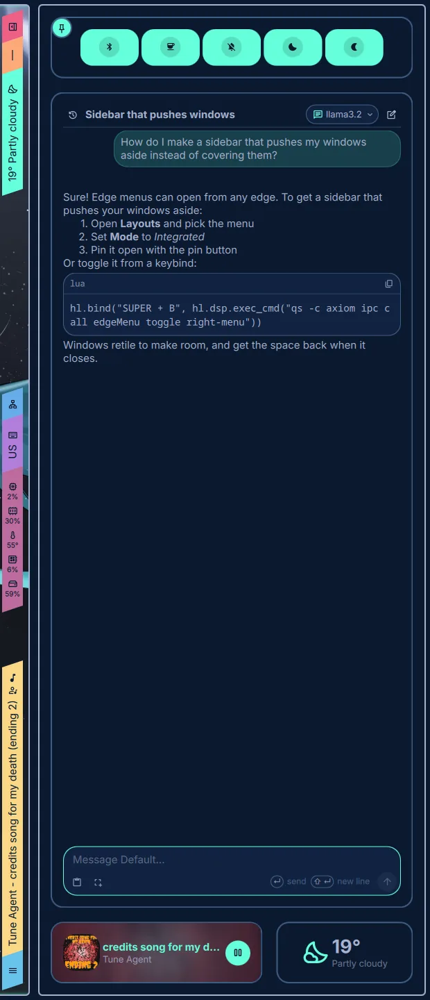 | 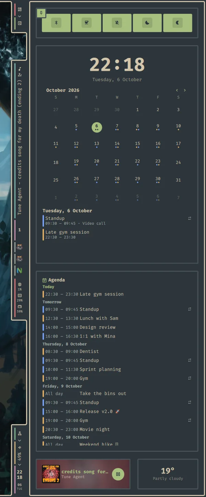 |
| **Top: wallpaper and theme, dropping from a pill** | **Right: a notepad** | |
| 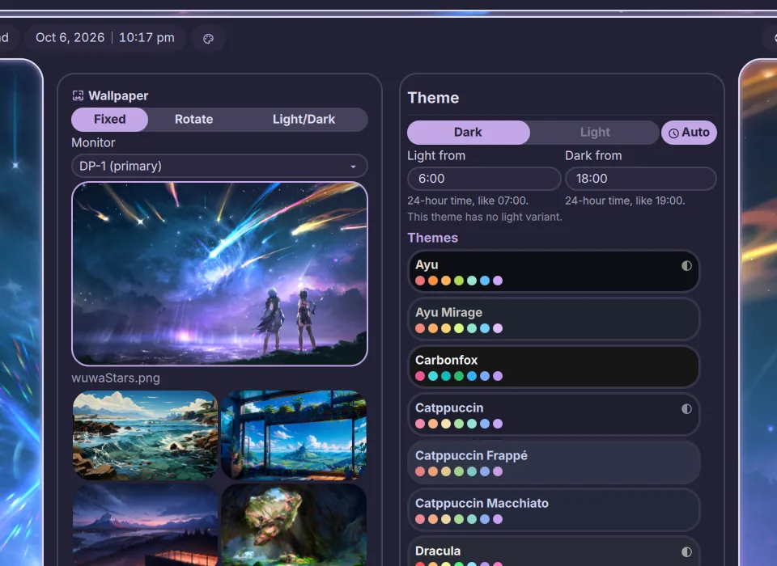 | 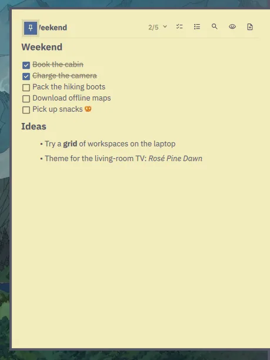 | |

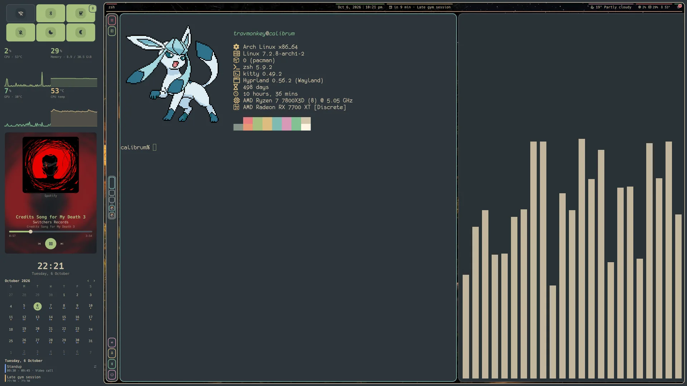

## Workspaces

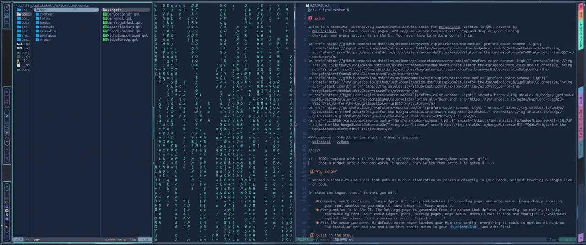

Set **Settings → Workspaces → Layout**:
- **Standard:** 1 to N, shared by every monitor.
- **Per monitor:** each monitor gets its own block of N.
- **Grid per monitor:** each monitor gets a grid (5×5 by default, up to 10×10) that you move around by row and column. On Hyprland, moving left or right slides sideways, and up or down slides vertically, whatever its own workspace animation is set to.

Then:
- **One setting, everywhere.** The bar widget, its popout, the workspace overview, the Workspaces module, the launcher's `/ws` and the `workspaces` IPC target all follow the layout.
- **A stable order.** The primary monitor comes first, so plugging one in or restarting the compositor never reshuffles which workspaces belong to which monitor. Changing the layout moves your windows to the matching place in the new one.
- **On niri**, workspaces are niri's own: a column per monitor that grows and shrinks as you use it. The bar and the overview follow it.
- **Scrolling strips.** On Hyprland, make any monitor (or every one) a strip, Hyprland's scrolling layout, horizontal or vertical. On niri, every monitor is one:
  - The bar shows the active workspace's windows in strip order, and its popout lists every workspace with its windows.
  - The mouse wheel scrolls the strip.
  - The overview shows the whole strip, off-screen columns included.
  - The **Strips** keybind preset adds swapping columns, resizing them and fitting the visible ones.
- **The overview** shows live window previews on Hyprland, and app icons elsewhere. Drag a window onto another workspace or onto a side of another window, right-drag to resize it, and middle-click to close it. Special workspaces get a column of their own on the right, which windows can be dragged into and out of (not on niri, which has no named special workspaces). Arrow keys, Enter and the digits drive it from the keyboard.
- **Keybinds included.** Presets for the grid with WASD or the arrows (add <kbd>Shift</kbd> to take the window along), or previous and next.

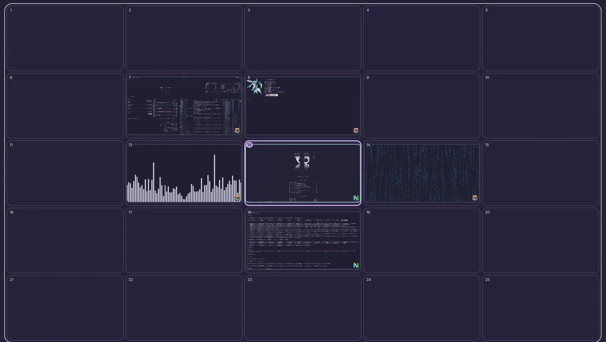

## Window switcher (Alt+Tab)

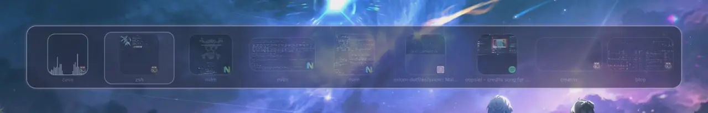

- <kbd>Alt</kbd>+<kbd>Tab</kbd> and <kbd>Alt</kbd>+<kbd>Shift</kbd>+<kbd>Tab</kbd> step through your windows, most recently used first, on the focused monitor. Let go of <kbd>Alt</kbd> to switch, press <kbd>Esc</kbd> to stay, or click a tile.
- It only appears once you've held the keys for a moment, so a quick tap just swaps to your last window without anything drawn.
- Show windows from everywhere, from this monitor only, or from this workspace only, as live previews or app icons, at the tile size you like (**Settings → Workspaces → Window switcher**).
- The compositor holds the keys (on sway and niri, the switcher takes the keyboard while it's open), so it never misses a fast release. It's on the Keybinds page as a preset, and on any other combination you like.

## Your compositor

axiom runs on Hyprland, niri and sway, and sets up the compositor from the same settings on each (**Settings → Compositor**):
- **Keybinds** on their own page, with presets, a key recorder, and warnings for keys your own config already uses, plus a reference of every bind as a list or a keyboard, where you can press a combo to see what it does.
- **Window rules** (the Window rules page): float, size, place, pin or fullscreen windows as they open, by app id, title, process, the program that started it, whether it's a game or an installed app; `/rule` makes one from the focused window; while one is open, focused or fullscreen, do not disturb, keep the screen awake or hold a power profile, or hide them from the dock, switcher, workspace icons and launcher. Written into each compositor's config in every mode.
- **Monitors** arranged by dragging (see [the rest](#the-rest)).
- **Window look:** theme-colored borders, rounding, gaps, shadows, dimming, opacity and blur, as far as the compositor supports them. **Match axiom's shape** keeps windows in step with axiom's own shape.
- **Input:** input sources (keyboard layouts and, through fcitx5 or ibus, input methods for Japanese, Chinese, Korean and more, switched from the bar, a keybind or the OSD), key repeat, mouse and touchpad, and the cursor theme.
- **Three modes:** applied at runtime without touching your config (the default), written to a file you include, or the whole config managed by axiom with your own files loaded after it. See [Compositor modes](installation.md#compositor-modes).

One config works on all three. Switch compositors and your bars, pages, theme and keybinds come along; settings only one compositor understands stay in the config for when you go back. What each compositor supports is in the [README](../README.md#compositors).

## Calendar

| The Calendar page | In the bar |
| :---: | :---: |
| 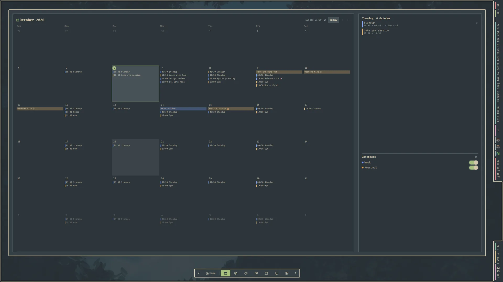 |  |

- **Sources:** your calendars from **CalDAV** accounts (iCloud, Fastmail, Nextcloud or any CalDAV server), read-only **.ics subscriptions** (holidays, shared feeds, Google's secret iCal address), and **local calendars** kept on this computer (one `.ics` file per event in `~/.local/share/axiom/calendars/`).
  - Add accounts in **Settings → Calendar**, then pick which of an account's calendars show.
  - Give any calendar a theme color in place of the server's.
  - Passwords go to your keyring, never into the config.
- **Days with events** get a dot per calendar, in the calendar popout, the **Calendar** and **Clock & calendar** modules, and the **Calendar** page.
  - Click a day to see its events, and an event to edit it.
  - Recurring events ask whether a change is for that one or all of them.
  - The **Clock & calendar** module lists the day's events where they fit. It can also show them on the lock screen, read-only.
- **The Calendar page** shows the month large, with the events in it, and switches calendars on and off.
- An **Agenda** module lists what's coming up, and the **NextEvent** bar widget shows the next event ("in 10 min · Standup").
- **Reminders** from your events show as notifications.
- **Quick add** from the launcher: `/event tomorrow 3pm Dentist`, `/event fri 9-10:30 Planning`, `/event 2026-12-24 all day Holiday`.
- **Syncing:** it syncs every few minutes while something shows a calendar (or reminders are on), and keeps a copy on disk, so it shows at once and works offline. Events never show on the login screen.

## Launcher

| Apps | Commands | Calculator | Emoji |
| :---: | :---: | :---: | :---: |
| 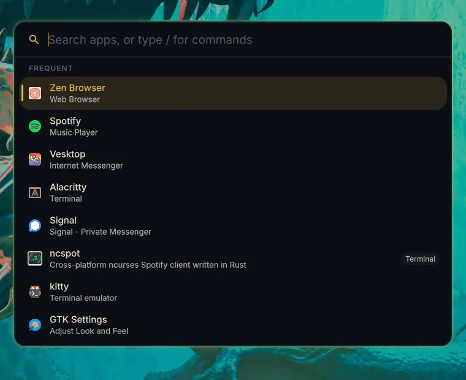 | 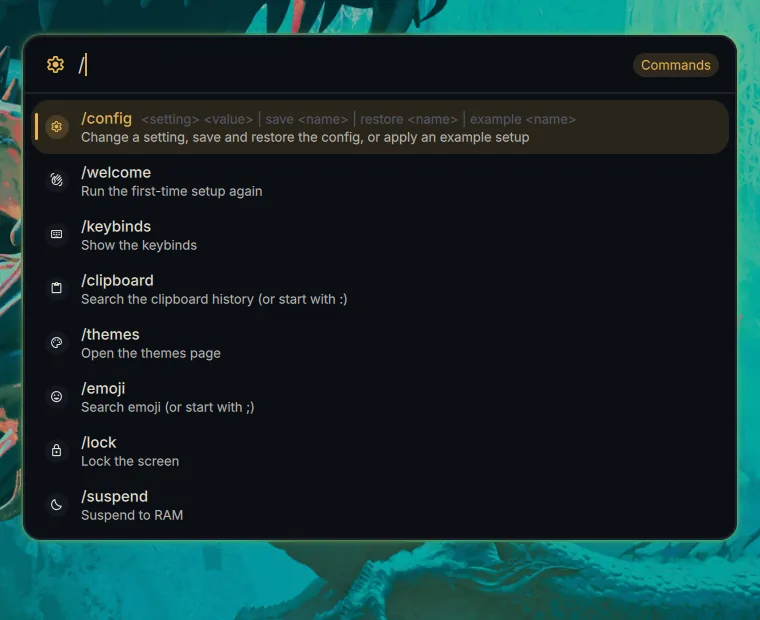 | 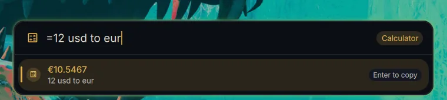 | 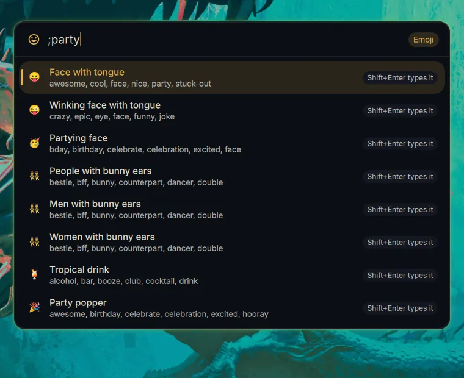 |

- **Search:** apps (ranked by how often and how recently you use them), open windows, your files (`~`: a search, folders, recent files, thumbnails), a calculator (math, units, currencies), the web, your clipboard history and emoji.
- **Commands:** it runs shell commands, asks your AI chat, and controls the whole shell with `/` commands. Commands that change something you can see (the theme, the volume, the wallpaper) keep the launcher open, so you can try several.
- **Placement:** floating, centred or in the upper third, or attached to the top or bottom edge like the other edge popouts. The field can sit above or below the results.

Every prefix and command is listed in [Keybinds, IPC and launcher](usage.md#launcher).

## Dock and OSD

| Dock | OSD (a column of bars) | OSD (a row of bars) |
| :---: | :---: | :---: |
| 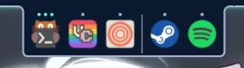 | 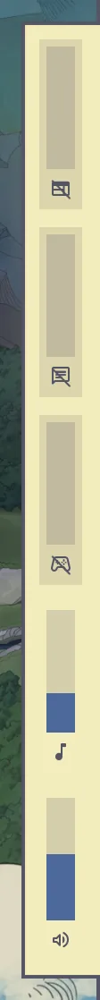 | 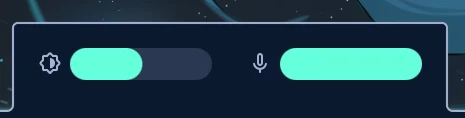 |

**Dock:**
- **Contents:** your pinned apps, then the apps with open windows, grouped by app. A dot or line shows what's running, and a separator splits the two.
- **Using it:**
  - Click to launch or focus an app; clicking again cycles its windows.
  - Right-click for the app's menu.
  - Drag icons to reorder or pin them, or off the dock to unpin.
  - Icons magnify under the pointer, and a tooltip names each app.
- **Visibility:** always shown, shown on hover, or hidden while a window overlaps it. Running apps can count windows everywhere, on the dock's monitor only, or on its workspace only.

**OSD:**
- **Levels:** each OSD holds the bars you pick: output and microphone volume, brightness, the volume of the apps you choose, or of every other app. A change opens every OSD holding that bar. What you change with the mouse in axiom's own bar and panels doesn't open it (a setting turns that on), keys and other apps always do.
- **Status icons:** Caps, Num and Scroll Lock, the keyboard layout, the audio output and the microphone (struck through while muted, a card naming the device when it switches), the power profile, caffeine, do not disturb, night light, Wi-Fi, Bluetooth, airplane mode, the charger, a VPN, a screen recording, and apps using the camera or microphone or sharing the screen, as a row of icons: only what's out of the ordinary (Caps Lock on, muted, on battery, …), every one you pick, or only the one that changed. Icons that are on are lit in the accent. One changing shows the icons, the change ringed, and an action that can't run here (a bind for screen recording without wf-recorder, …) says what and why on a card in the warning colour; add what each OSD shows from a list (lock keys, audio, connections, …) in the order you want, each with its icons, its card and whether it opens the OSD (quiet) switched on its own. Click an icon to flip it (Wi-Fi, Bluetooth, do not disturb, the microphone, the next layout, …), and a bar's icon to mute it. Some changes show a card with more to say instead of the icons, for a few seconds (detail cards, which can be turned off; the icon is lit next time the icons show): an audio device switching names it (a Bluetooth headset's profile switching doesn't count), a VPN connecting (and dropping by itself), an app starting to use the camera or microphone or share the screen (one card for a call), a Wi-Fi network joined, the charger plugged in, a removable drive plugged in, mounted or ejected, the battery running low (and critical, which still sends an urgent notification), Bluetooth devices connecting or disconnecting (one card for several, a headset's audio switch folded in), a Bluetooth device's battery running low.
- **Cards:** besides the icons' cards, each OSD picks what is only ever a card: a monitor connected or removed, a screenshot taken (its picture; click to open it), messages, and the track playing (on a new track, and optionally on play and pause). Drives, the battery, monitors, screenshots and messages an OSD shows go there instead of as notifications (a drive or the battery picked to stay quiet, or with the OSD's cards off, they're notifications as before), and those cards are kept in the notification history too, without a popup. Turn an OSD's cards off and it shows none at all. Scripts can show their own card: `axiom message <icon> <text>`, with `--detail <text>` for a second line and `--osd <id>` for another OSD; with no OSD picking messages it's a notification.
- **Parts:** a volume change shows just the bars, a status change just the icons, a card just the card. When several show at once they're stacked in one box, the bars by the edge and the icons past them (or the other way round) and a card last, the box as long as the longest, and share their time: the bars and icons close together, folding in before the OSD slides away or sliding away as one, while a card keeps its own time. A card that comes as it closes waits until it's gone. Nothing moves while the mouse is on it.
- **Layout:** it can open on hover too, and pointing at it brings out the bars and icons; lay its bars along the edge or across it.

**Both:**
- **Placement:** have any number, on any edge, at any position along it. Put them on a named monitor, the primary, the focused one (following focus) or every monitor.
- **Edges:** attached, they grow out of the screen border or a solid bar, like the popouts. Detached, they're a box held a distance across the free screen (0 lines it up with your windows, 50% centres it) that slides in from off the screen or fades in where it sits.
- **Sharing an edge:** a dock gives way to an OSD, and both give way to a floating edge menu opened on their edge.
- Edit them under **Settings → Dock** and **Settings → OSD**.

## Lock screen, login screen and polkit

| Lock screen | Login screen |
| :---: | :---: |
| 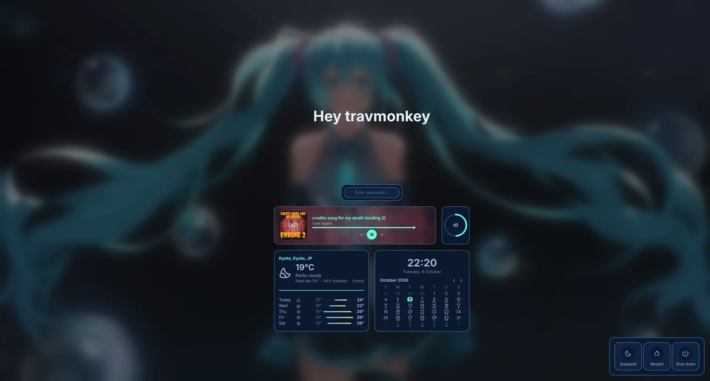 | 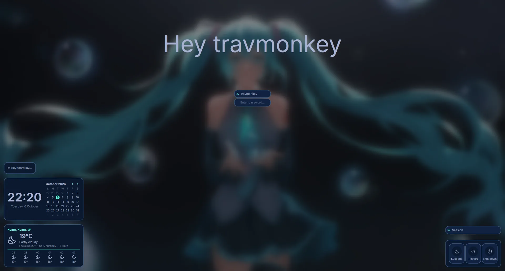 |

- **Lock screen modes:**
  - **Built-in** (`ext-session-lock`, PAM): the lock screen is laid out on the Layouts page, like an overlay page. Put a greeting, the password field, a clock, media, weather, power buttons (suspend, restart, shut down) and other display-only modules anywhere on a grid fitted to each monitor. It shows over your wallpaper (blurred and dimmed) or a color, and **Show on screen** previews it.
  - **None:** use your own locker.
- **Login screen:** optional, through greetd.
  - Laid out the same way, with a login box (pick or type the user, with their picture), a session picker, the keyboard layout, power buttons and the same display-only modules.
  - Drawn in your theme, wallpapers and monitor layout.
  - Remembers the last user and their session.
  - Installed and updated from Settings with one password prompt; changing its look needs none. See [Login screen](installation.md#login-screen-greetd).
- **Caps Lock warning:** every password field (the lock screen, the login screen, polkit, Wi-Fi, VPN and account keys) shows when Caps Lock is on, read from the keyboard's LED on any compositor.
- **Polkit prompt:** when an app asks for admin rights, the screen dims and a password prompt opens on the focused monitor, in your theme. Every other password or code the system asks for uses the same prompt, one at a time: Bluetooth pairing (confirm a code, type a PIN or passkey, or a code to type on a keyboard), a VPN's secrets, a Wi-Fi password asked with no Wi-Fi menu open, and a drive's passphrase from its card or notification.
  - Switch which identity to authenticate as.
  - Turn it on under **Settings → Screen & Power → Authentication prompts**. axiom stops the other agent you had (hyprpolkitagent, KDE's, GNOME's), and starts it again if you turn axiom's off.

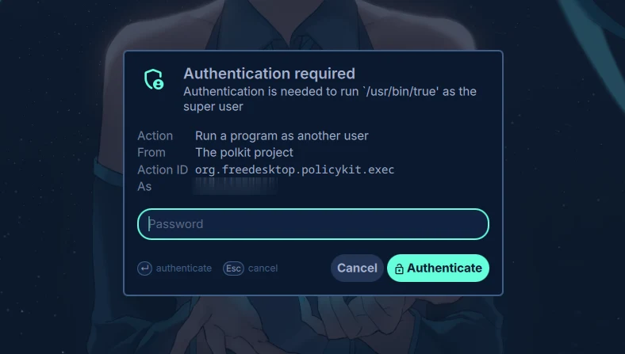

## Theming

| Dark | Light |
| :---: | :---: |
| 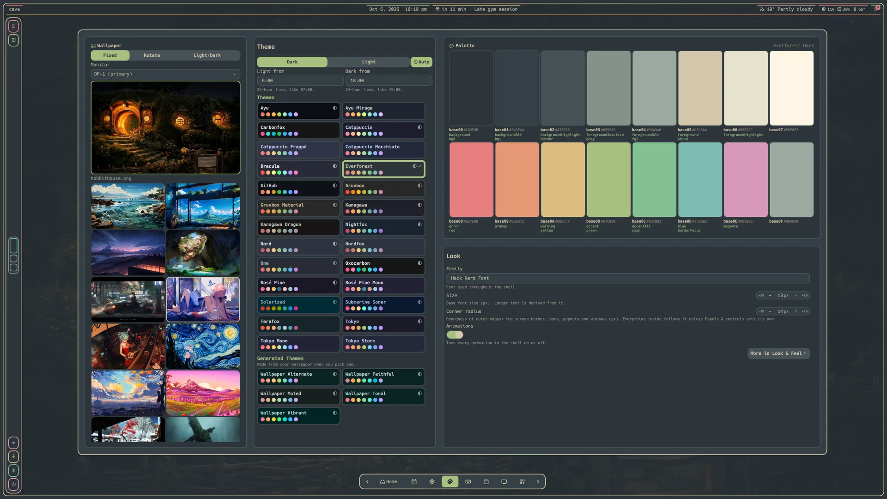 | 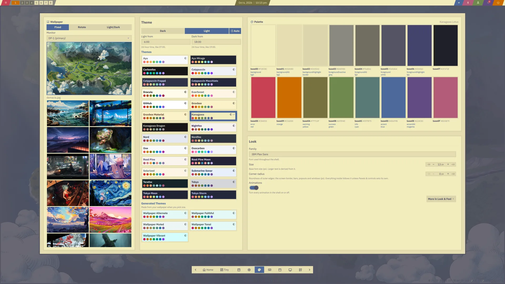 |

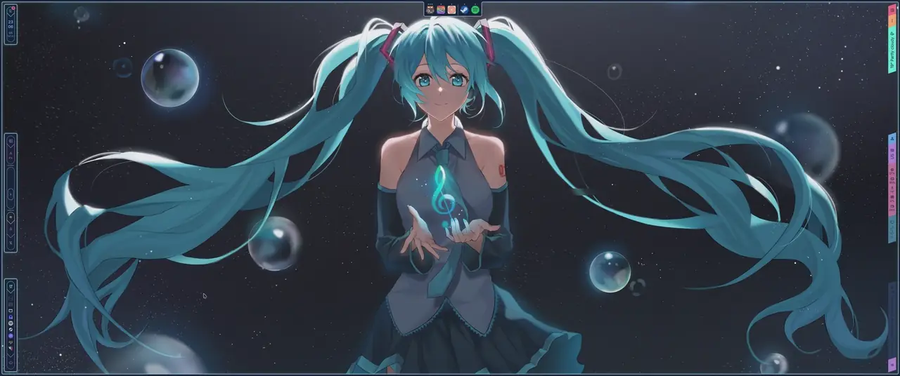

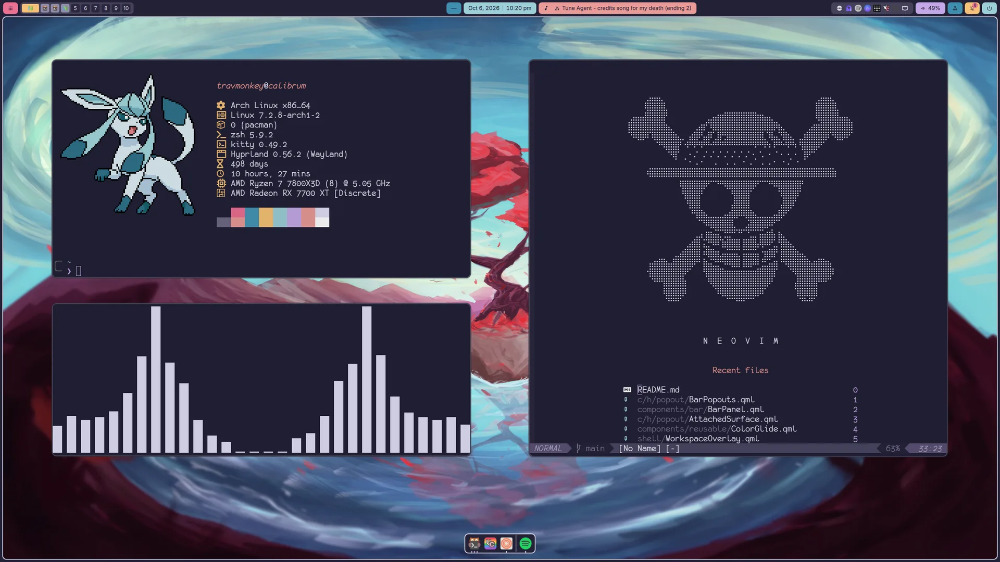

- **42 base16 themes**, with dark and light pairs switched by one toggle: Catppuccin, Gruvbox, Gruvbox Material, Solarized, Tokyo Night, Rosé Pine, Nord, Dracula/Alucard, Everforest, Kanagawa, One, Ayu, Nightfox (with Carbonfox, Dayfox, Nordfox and Terafox), GitHub, Oxocarbon and Submarine Sonar.
- **Generated themes** from your wallpaper, in five styles (tonal, vibrant, faithful, muted, alternate). The palette is built in OKLCH from the image's main colors, to match the contrast of the hand-made themes.
- **Light and dark** by hand, or on a schedule.
- **Wallpapers** can be set per monitor:
  - Fixed, rotating on a timer, or one for light mode and one for dark. A random rotation shuffles: every wallpaper shows once before any comes back. It can wait while a window is fullscreen, the screen is locked, or on battery.
  - Pick from the whole folder, one of its subfolders (a collection), or every folder inside it.
  - Fifteen transitions: fade, wipe, slide, grow, shrink, wave, dissolve, pixelate, blinds, tiles, zoom, ripple, swirl, blur and clock. Random picks from the ones you tick, and every monitor changing together plays the same one. Each can be aimed: a direction to move in (fade and co. sweep along it), a place to start from, or where you click a wallpaper in a picker, each random by default; and a pace (smooth, slowing down, speeding up, steady or snappy). The lock screen and login screen use them too. Try one with `/transition` in the launcher.
  - Fill the screen, show the whole image, stretch it or center it at its own size.
  - Workspace parallax: the wallpaper slides a little with each workspace you go to (by row and column on a grid), and sideways as you scroll along niri's or Hyprland's scrolling layout. On niri, axiom keeps the wallpaper still behind the workspaces as they slide, so the parallax shows.
- **Other apps** follow the active theme too:
  - Each app is a switch under **Settings → Theme integrations**, one card per app, and gets its own `axiom` theme file.
  - Its switch shows the line that loads that file from the app's config. Copy the line, or click **Apply**, which backs your config up first.
  - Nothing else ever edits your config files.

<b>Supported apps (23)</b>

| Kind | Apps |
| --- | --- |
| Toolkits | GTK, Qt |
| Input methods | fcitx5 (its candidate window and menus); ibus's candidate window follows GTK |
| Terminals | kitty, Alacritty, foot, WezTerm, Ghostty |
| Editors | Neovim, Helix, VS Code, Zed |
| Apps | Firefox (and its forks), Vesktop/Vencord, zathura |
| CLI tools | k9s, cava, btop, fzf, lazygit, bat/delta, Yazi, ncspot |

## The rest

| Notification | Power menu | First-run setup |
| :---: | :---: | :---: |
| 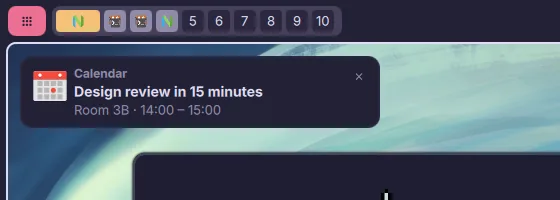 | 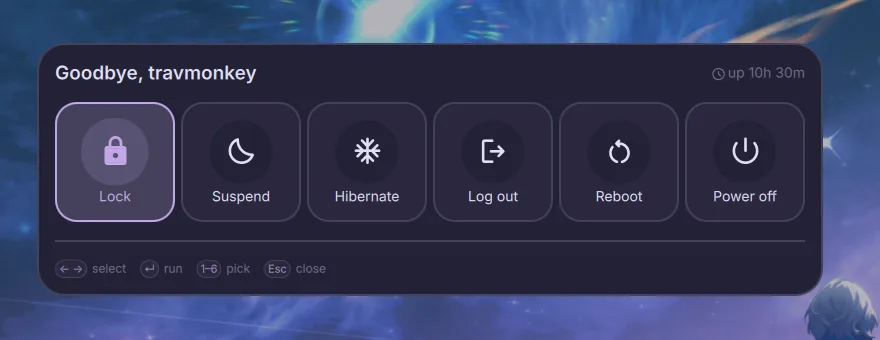 | 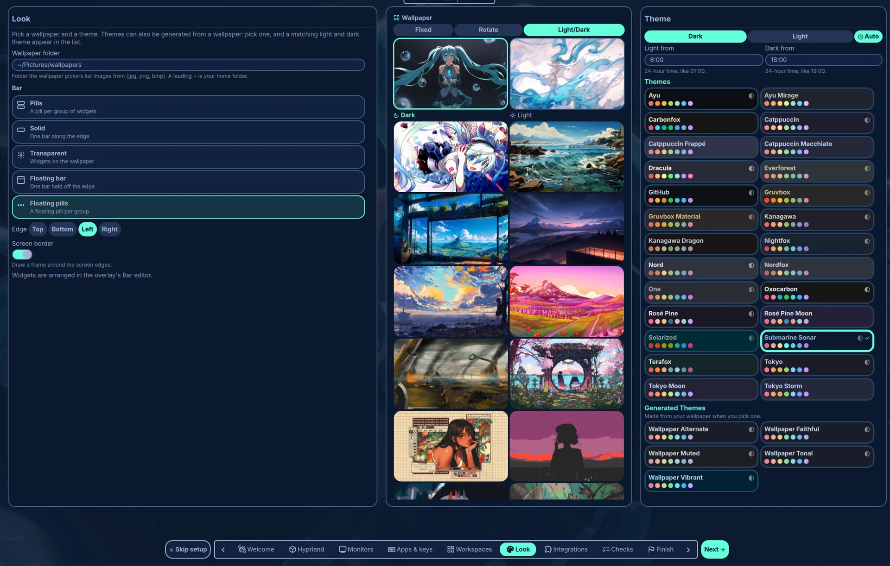 |

- **Notifications:** toasts and a notification center.
  - Toasts stack from any corner of one monitor or all of them, with gaps measured from the bar or border at each edge.
  - Set how long they stay (or use the app's own timeout), keep critical ones up, and keep them quiet over fullscreen windows.
  - The history can drop an app's notifications when you focus it, or when you click or close them, and has a size and age limit.
  - Do not disturb is kept across restarts.
- **Community setups:** a gallery of looks other people built and shared ([community-setups](https://github.com/axiom-shell/community-setups)), searchable by name and tag in **Settings → System** or with `/config community`. Applying one takes its look and layout (optionally its wallpaper) and saves yours first; it never brings commands, monitors or accounts. See [Configuration](configuration.md#community-setups).
- **AI chat:** Anthropic, OpenAI, Gemini, or anything with an OpenAI-style API (Ollama, LM Studio, OpenRouter, …).
  - Replies stream in as formatted Markdown with copyable code blocks and folded thinking.
  - Saved conversations, and presets (system prompt, model, effort).
  - Image attachments: paste, screenshot a region, or drop.
  - `@` in the launcher asks a question.
  - API keys come from environment variables, your keyring or a mode-600 secrets file, never `config.json`.
- **Notes:** Markdown files in a folder you choose, edited in place with task checkboxes. A note open in two places stays in sync, and `/notes` in the launcher searches them all.
- **Todo list and pomodoro timer:** one list and one timer, on the bar, in popouts and as modules. Pick the todo a session is for; a notification marks each session's and break's end. `/todo` adds or ticks off, `/pomodoro` starts, pauses or skips.
- **Timer and stopwatch:** a one-off timer (`/timer 10m tea`, or a preset) and a stopwatch with laps, both able to run at once, on the bar, in a popout or as a module.
- **Hot corners:** rest the pointer in a screen corner to run any axiom action (the overlay or a page, the launcher, the workspace overview, lock, do not disturb, media, …) or your own command, per corner and monitor, with an optional delay; a corner can also toggle a special workspace where the compositor has named ones. They work on every compositor and stay quiet over fullscreen windows.
- **Power menu:** your choice of session actions, in your order, driven by mouse or keyboard. Log out, restart and shut down ask you to confirm.
- **Monitors:** a page to arrange monitors by dragging (they snap edge to edge).
  - Set each one's mode, scale, rotation and VRR, and on Hyprland mirroring, bit depth and color management.
  - One layout is kept per set of connected monitors, and switches on its own when you plug one in.
  - **Apply** asks you to keep the change, and puts the old layout back after 15 seconds if you don't.
- **Your account and computer:** **Settings → General** opens on your account: your picture (also on the login screen, and on the lock screen with the Greeting module's Picture), your real name, and changing your password. **Settings → System** opens on the computer: its name (rename it there), the distribution, kernel, processor, graphics, memory and disk, the versions of axiom, Quickshell and the compositor, and **Copy system info** for a bug report (versions only, never your names).
- **Default apps:** the browser, mail, file manager, terminal, text editor, image and video viewers, music player, PDF reader and archive manager every app uses (your `mimeapps.list`), picked from the installed apps in **Settings → General → Default apps**, and any other file type by name. The keybinds and everything axiom opens follow them; `axiom open` opens a link, a file or any of them from a script. A file type no app claims opens in the app of the type it's a kind of (a script with no app of its own in the text editor). Any of them can be a custom command of your own instead, for axiom (Custom command… in its picker).
- **Date and time:** the time zone (searched by city), network time, or the time set by hand, in **Settings → System → Date & time**, and how times and dates read everywhere: a 12- or 24-hour clock, the date order (or ISO), the first day of the week, and a region apart from the language (English text with German dates). Each clock can still keep its own.
- **Multi-monitor:** interactive surfaces open on the primary monitor, on whichever monitor has focus, or on all of them at once.
- **First-run setup:** a guided tour, applied as you go, through:
  - the look, monitors and workspaces
  - default apps and keys
  - the compositor mode, and the optional integrations (login screen, polkit, idle)
  - other apps in axiom's colors

  `/welcome` runs it again.
- **Screenshots:** a region, a window or a whole screen, picked on a frozen frame. Saved and copied, or opened in satty or swappy to annotate. Also screen recording with `wf-recorder`, with the microphone or (with `pactl`) the system's sound.
- **Screen sharing:** axiom's own picker when an app shares the screen (a call, a stream), in place of the portal's: a screen, a window or (on Hyprland) a region, on Hyprland, niri and sway. Set up once in **Settings → Screen & Power → Screen sharing**.
- **Brightness:** keys and an OSD bar for a laptop screen and for external monitors over DDC/CI.
- **Night light:** warmer colors on a schedule, set by axiom through the compositor (`wlsunset` on niri).
- **Idle:** axiom handles idle itself, on any compositor: dim, lock, screen off and suspend timeouts, and locking before the computer sleeps.
- **Updates:** axiom updates itself from git, following releases or `main`, with a notification or automatically, and switches to the rebuilt `axiom` binary without logging out.
- **Dev mode**, for working on axiom: `axiom dev set <clone>` and `axiom dev on` run your clone instead of the install, rebuilt as you edit it, on a config of its own; **Settings → Development** shows how it differs from yours and copies settings either way.
- **The `axiom` command:** the shell's parent process, and a command line for scripts and keybinds.
  - Run, restart or stop the shell (`axiom run`, `axiom restart`, `axiom quit`). If the shell crashes, axiom starts it again, locked first if it was locked.
  - Drive any surface: `axiom launcher toggle`, `axiom volume up`, `axiom screenshot take region`, or any IPC target with `axiom ipc` (see [IPC](usage.md#ipc)).
  - `axiom lock` succeeds only once the lock screen is really up, so idle daemons can rely on it.
  - Read and change any setting: `axiom config get Bars`, `axiom config set Appearance.font.size 14`, `axiom config validate`.
- **Translations:** English and Japanese, with more added as a single JSON file each.

<b>AI chat</b>

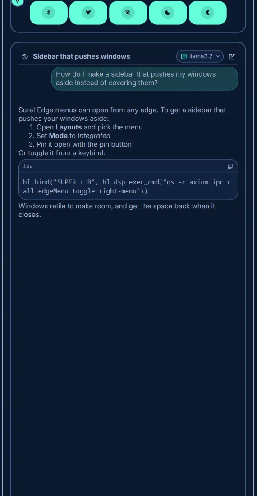

