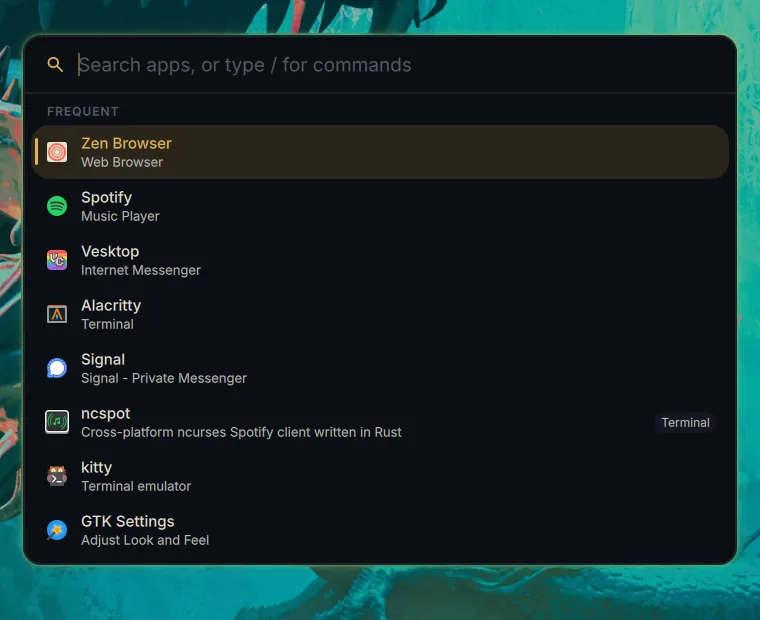
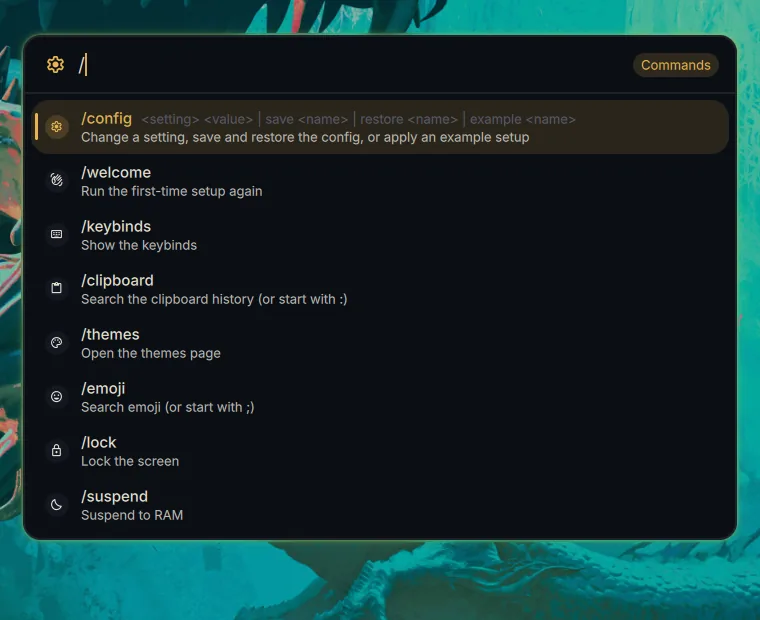
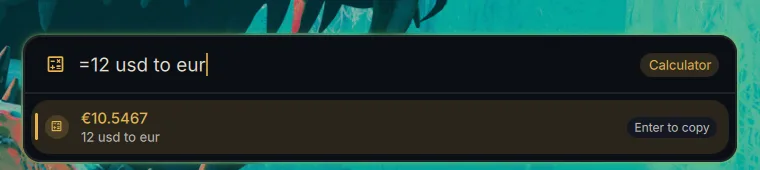
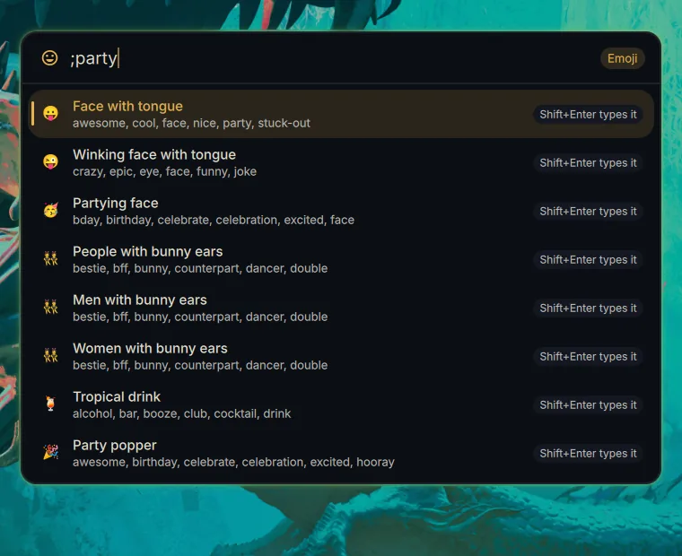

# Keybinds, IPC and launcher

[README](../README.md) · [Features](features.md) · [Installation](installation.md) · [Keybinds, IPC and launcher](usage.md) · [Configuration](configuration.md)

## Keybinds

Keybinds are edited on the overlay's **Keybinds** page: the binds by section on the left, the selected one in full on the right. Search, filter by section or modifier, record a key by pressing it, and drag a bind to reorder it. With nothing selected, the right side is a key map of which keys are free under the modifiers you pick: click a free key to bind it. A bind's switch pauses it (kept in the list, but not bound), and a section's switch pauses all of it. **Presets** shows what each set of binds would add or replace before you apply it; a removal or preset can be undone until you save.

**All binds** is the quick reference: every bind your compositor has, axiom's and your own, by section and grouped under their modifiers (click a group to fold it), with direction and number sets folded into one row. Press a combo in **Look up a combo** to see what it does, or bind it if nothing does. **Keyboard** shows the same binds on a keyboard under the modifiers you pick. Click one of axiom's binds in either to edit it. The Cheatsheet module shows the reference on any page, as a list or a keyboard.

A bind can run:
- any IPC action below, picked from a list: axiom's surfaces, **System** toggles (Wi-Fi, Bluetooth, VPN, dark mode, caffeine, night light, do not disturb, the microphone), **Tools** (clipboard history, emoji, calculator, notes, calendar, chat, pomodoro, stopwatch and timers), media keys and switching the audio output
- a window action (focus, move, resize, close, fullscreen, floating, special workspaces, mouse drag)
- a raw command in the compositor's own language: a Hyprland dispatcher as Lua (`hl.dsp.layout("swapsplit")`), a sway command or a niri action. It's kept for the compositor it was written for, and skipped (with a warning) on the others
- a command

An action that switches something on and off (or opens and closes it) can toggle it, or only turn it on or only off. It can repeat while held, work while locked, or fire on release. A description like `Workspace: Switch left` puts the bind in its own section on the page.

**Presets** add a set of binds in one click, skipping any key you already use (Southpaw, marked ⇄, rebinds its keys instead):

| Preset | Binds |
| --- | --- |
| Essentials | Launcher, overlay, workspace overview, power menu and lock |
| Workspaces 1–N | <kbd>Super</kbd> + number goes to a workspace, with <kbd>Shift</kbd> it takes the window along |
| Grid with WASD | <kbd>Super</kbd> + <kbd>W</kbd> <kbd>A</kbd> <kbd>S</kbd> <kbd>D</kbd> moves around the grid, with <kbd>Shift</kbd> it takes the window along |
| Grid with arrows / Previous and next | <kbd>Super</kbd> + <kbd>Ctrl</kbd> + arrows moves around the grid (or steps through workspaces), with <kbd>Shift</kbd> it takes the window along |
| Window management | <kbd>Super</kbd> + <kbd>H</kbd> <kbd>J</kbd> <kbd>K</kbd> <kbd>L</kbd> moves focus, with <kbd>Shift</kbd> the window, with <kbd>Alt</kbd> resizes it; close, fullscreen, floating, mouse drag, and <kbd>Super</kbd> + scroll along the strip (or through the workspaces) |
| Southpaw (grid or per-monitor workspaces) | <kbd>Super</kbd> + <kbd>W</kbd> / <kbd>S</kbd> up and down the workspaces, <kbd>H</kbd> / <kbd>L</kbd> left and right (the next monitor with per-monitor workspaces), <kbd>A</kbd> <kbd>D</kbd> <kbd>J</kbd> <kbd>K</kbd> move focus; with <kbd>Shift</kbd> the window goes along |
| Window switcher | <kbd>Alt</kbd> + <kbd>Tab</kbd> steps through your windows, most recently used first, with <kbd>Shift</kbd> backwards; releasing <kbd>Alt</kbd> picks |
| Strips (with a strip monitor) | <kbd>Super</kbd> + <kbd>[</kbd> / <kbd>]</kbd> swaps columns, <kbd>Super</kbd> + <kbd>=</kbd> / <kbd>-</kbd> steps the width, <kbd>Super</kbd> + <kbd>Ctrl</kbd> + <kbd>F</kbd> fits the visible columns, <kbd>Super</kbd> + scroll moves focus along the strip (the strip binds are also in the defaults) |
| Media keys | Volume, mute, microphone, brightness and playback keys, through axiom (the OSD shows volume and mute changes) |

The page only offers actions your compositor can do. In managed mode, **Merge** moves the binds from your own files in the compositor's `user/` folder onto this page.

## IPC

Every surface can be controlled over IPC, so you can bind it to anything:

```bash
axiom ipc <target> <function> [args]
```

<details>
<summary><b>IPC targets</b></summary>

| Target | Functions |
| --- | --- |
| `overlay` | `open`, `close`, `toggle`, `page <type>` (a page in a window of its own: its window) |
| `pages` | `window <type>` (a tool page in a window of its own, or its window focused: `settings`, `themes`, `bareditor`, `keybinds`, `customwidgets`, `calendarpage`), `close <type>` (back into the overlay), `list` |
| `edgeMenu` | `open <id>`, `close <id>`, `toggle <id>`, `pin <id>`, `unpin <id>`, `list`, `edit` |
| `dock` | `open <id>`, `close <id>`, `toggle <id>` (no id: every dock) |
| `bar` | `reveal <id>` (shows an auto-hiding bar for its Shown for time), `toggle <id>` (pins it shown, reserving its space, or unpins it), `hide <id>` (unpins and hides it now); `<id>` is a bar's id, or `focused` (or `""`) for the auto-hiding bars on the focused monitor. Bindable as the **Auto-hiding bar** keybind action (Pin or unpin, Show, Hide) |
| `appLauncher` | `open`, `close`, `toggle`, `search <text>`, `clipboard`, `emoji`, `calculator` (opens on that history or picker) |
| `powermenu` | `open`, `close`, `toggle` |
| `osd` | `show <id>` (messages: `axiom message`) |
| `workspaceOverlay` | `open`, `hide`, `toggle` |
| `workspaces` | `go <id>`, `move <id>`, `moveSilent <id>`, `left`, `right`, `up`, `down`, `step <direction> <mode>`, `scroll <direction>`, `nth <n> <mode>`, `reconcile` |
| `windowSwitcher` | `next`, `previous`, `commit`, `cancel` (for scripts: the Alt+Tab bind doesn't need them) |
| `idleInhibit` | `enable`, `disable`, `toggle`, `timer <duration>`, `status` |
| `nightLight` | `enable`, `disable`, `toggle`, `status` |
| `darkMode` | `enable`, `disable`, `toggle` (the theme's dark or light variant) |
| `wifi` | `enable`, `disable`, `toggle` |
| `bluetooth` | `enable`, `disable`, `toggle` |
| `vpn` | `toggle` (the VPN last used, as the Vpn widget's click) |
| `inputSources` | `next`, `prev` (the next or previous input source: the **Next / Previous input source** keybind actions), `set <id>` (an `Input.sources` id), `list` (the sources as JSON, the current one marked) |
| `drives` | `list` (the removable drives as JSON), `mount <id>` (a drive's volumes, or one volume), `eject <id>`, `ejectAll` |
| `brightness` | `up`, `down`, `set <percent>`, `dim <percent>`, `dimBy <percent>`, `undim` |
| `screenshot` | `take <region\|window\|screen>`, `cancel` |
| `screenRecord` | `toggle`, `enable`, `disable`, `status` |
| `wallpaper` | `next`, `random`, `preview <transition>` (the next wallpaper, played with that transition: `fade`, `wipe`, `slide`, `grow`, `shrink`, `wave`, `dissolve`, `pixelate`, `blinds`, `tiles`, `zoom`, `ripple`, `swirl`, `blur`, `clock`) |
| `monitors` | `open`, `keep`, `revert`, `identify` |
| `onboarding` | `open`, `close`, `goTo <step>`, `reset` |
| `lockscreen` | `lock` |
| `greeter` | `open` (its settings), `preview` (the login screen's layout, on screen) |
| `notifications` | `clear` (every notification, no undo), `clearQuiet` (the Quiet section's), `toggleQuiet` (fold the Quiet section open or shut), `toggleDnd` |
| `dnd` | `enable`, `disable`, `toggle`, `status` (do not disturb) |
| `selfUpdate` | `check`, `update`, `open` |
| `community` | `refresh`, `list` (each setup's id and title), `apply <id>` (without its wallpaper) |
| `chat` | `open`, `newChat`, `ask <text>`, `settings` |
| `calendar` | `open`, `newEvent`, `sync`, `add <text>` (as `/event`) |
| `notes` | `open` (the overlay page or edge menu with a Notes module) |
| `todo` | `add <text>`, `toggle <text>`, `list`, `count`, `clearCompleted` |
| `customWidgets` | `refresh <name>` (a custom widget's refresh name, id or name: its script runs again now), `list` |
| `pomodoro` | `start`, `pause`, `toggle`, `skip`, `stop`, `reset`, `status` |
| `stopwatch` | `timer <duration [label]>`, `toggleTimer`, `resetTimer`, `toggle`, `lap`, `reset`, `status` |
| `audio` | `volumeUp`, `volumeDown`, `toggleMute`, `toggleMicMute`, `nextOutput` (the next audio output) |
| `microphone` | `enable` (unmuted), `disable` (muted), `toggle`, `status` (whether it's on) |
| `media` | `playPause`, `next`, `previous`, `stop` |
| `popouts` | `list` (debugging: every open popout's claim and footprint) |

</details>

The common actions also have their own commands, which are easier to remember: `axiom launcher toggle`, `axiom overlay toggle`, `axiom volume up`, `axiom mic toggle`, `axiom dnd on`, `axiom message info "Backup done"`, `axiom brightness down`, `axiom media play-pause`, `axiom screenshot take region`, `axiom lock`. `axiom --help` lists them all, and `axiom <command> --help` each one's options.

To bind them in your compositor's own config instead, run the same command. On Hyprland, a `"Section: Label"` description also sets where the bind appears on the Keybinds page:

```lua
-- hyprland.lua
hl.bind("SUPER + SPACE", hl.dsp.exec_cmd("axiom ipc appLauncher toggle"), { description = "Axiom: App launcher" })
```

```kdl
// niri config.kdl, inside binds { }
Mod+Space hotkey-overlay-title="Axiom: App launcher" { spawn-sh "axiom ipc appLauncher toggle"; }
```

```
# sway config
bindsym $mod+space exec axiom ipc appLauncher toggle
```

## Launcher

Plain text searches apps and open windows. When the text is math, the result shows first, and a web search comes last. A prefix picks one kind of search:

| Prefix | Does |
| --- | --- |
| `/` | Shell commands (list below) |
| `=` | Calculator (qalc: math, units, currencies; convert with `to`, as in `=12 usd to eur`). Enter copies the result |
| `>` | Runs a shell command. Shift+Enter runs it in your terminal |
| `?` | Web search, with the engine set in Settings |
| `@` | Asks the overlay's chat, in a new conversation |
| `:` | Clipboard history. Shift+Enter removes an entry |
| `;` | Emoji, searched by name and keyword. Enter copies one, Shift+Enter also types it into the focused window |

| Apps | Commands | Calculator | Emoji |
| :---: | :---: | :---: | :---: |
|  |  |  |  |

<kbd>Tab</kbd> completes a command or its argument. Commands that change something you can see, like the theme, volume or wallpaper, keep the launcher open, so you can try several. `logout`, `reboot` and `poweroff` ask for a second <kbd>Enter</kbd>. Most commands have aliases (`/overview`, `/cal`, `/set`, …), which `/help` lists.

| Group | Commands |
| --- | --- |
| **Session** | `/lock` `/suspend` `/hibernate` `/logout` `/reboot` `/poweroff` `/power` |
| **Pages** | `/overlay [page]` `/settings` `/themes` `/bar` `/keybinds` `/layouts` `/menus` `/monitors` `/widgets` `/workspaces` `/calendar` |
| **Look** | `/theme <name>` `/dark` `/light` `/mode` `/wallpaper <file\|Random>` `/nextwallpaper` `/transition <name>` `/generate` `/nightlight` |
| **Audio and media** | `/volume <n\|+n\|-n>` `/mute` `/mic` `/output <device>` `/input <device>` `/play` `/next` `/prev` |
| **Connectivity** | `/wifi [on\|off]` `/bluetooth [on\|off]` `/connect <device>` `/vpn [name]` `/eject [drive]` |
| **Calendar and notes** | `/event <when> <title>` `/notes [text]` `/todo [text]` `/pomodoro [start\|pause\|skip\|stop]` `/timer <duration> [label]` `/stopwatch [start\|pause\|lap\|reset]` |
| **Searches** | `/calc` `/run` `/web` `/clipboard` `/emoji` `/chat [conversation]` |
| **Shell** | `/config <setting> <value>` `/config save <name>` `/config restore <name>` `/config example <name>` `/update` `/welcome` `/reload` `/help` |
| **Other** | `/dnd [on\|off]` `/clear` `/caffeine [on\|off\|30m]` `/dev [on\|off\|rebuild\|set <path>]` `/ws <n>` `/screenshot <region\|window\|screen>` `/record` |

Every provider can be switched off under **Settings → Launcher**. The same page sets:
- the launcher's size, hidden apps, terminal and search engine
- where it opens: floating (centred or in the upper third), or attached to the top or bottom edge like the other edge popouts
- whether the search field sits above or below the results
